# CS6650 HW5 – Product API

The Product endpoints from `api.yaml`, built with Gin, deployed to ECS with Terraform, load tested with Locust, and monitored with Prometheus + Grafana.

## Repo layout

| Path | Contents |
|---|---|
| `src/` | `product-service.go` (server) and `Dockerfile` |
| `terraform/` | `provider.tf`, `variables.tf`, `main.tf`, `outputs.tf`, `modules/` (network, ecr, logging, ecs) |
| `postman/` | Collection that triggers every response code |
| `locust/` | `locustfile.py` (HttpUser), `locustfile_fast.py` (FastHttpUser) |
| `observability/` | Local Prometheus + Grafana + Locust stack |
| `screenshots/` | Test results |

## Deploy to AWS

Requires the AWS CLI, Terraform, and Docker (running).

```
aws configure
aws configure set aws_session_token <TOKEN>     # Learner Lab credentials

cd terraform
terraform init
terraform apply -auto-approve                   # builds a linux/amd64 image, pushes to ECR, starts ECS
```

Get the public IP (from `terraform/`), then send a request:

```
aws ec2 describe-network-interfaces \
--network-interface-ids $(
    aws ecs describe-tasks \
    --cluster $(terraform output -raw ecs_cluster_name) \
    --tasks $(
        aws ecs list-tasks \
        --cluster $(terraform output -raw ecs_cluster_name) \
        --service-name $(terraform output -raw ecs_service_name) \
        --query 'taskArns[0]' --output text
    ) \
    --query "tasks[0].attachments[0].details[?name=='networkInterfaceId'].value" \
    --output text
) \
--query 'NetworkInterfaces[0].Association.PublicIp' \
--output text

curl http://<PUBLIC-IP>:8080/products/1
```

Clean up with `terraform destroy -auto-approve`. To run locally: `cd src && go run product-service.go`, or `docker build -t product-service src && docker run --rm -p 8080:8080 product-service`.

## API and response codes

Products 1–1000 are seeded at startup. The header `X-Simulate-Error: true` forces a 500.

| Request | Code |
|---|---|
| `GET /products/1` | 200 |
| `GET /products/99999` or `/products/abc` | 404 |
| `POST /products/2/details` with a valid body | 204 |
| `POST` with a missing field, `weight: -1`, `weight: 12.5`, body/path ID mismatch, malformed JSON, or path ID `0` | 400 |
| `POST /products/99999/details` | 404 |
| Either endpoint with `X-Simulate-Error: true` | 500 |

Valid body:
```json
{"product_id": 2, "sku": "ABC-123-XYZ", "manufacturer": "Acme Corporation", "category_id": 456, "weight": 1250, "some_other_id": 789}
```

To run every case, import `postman/hw5-product-api.postman_collection.json`, set `baseUrl`, and click **Run collection**. All 29 tests pass with `go run` and with Docker:

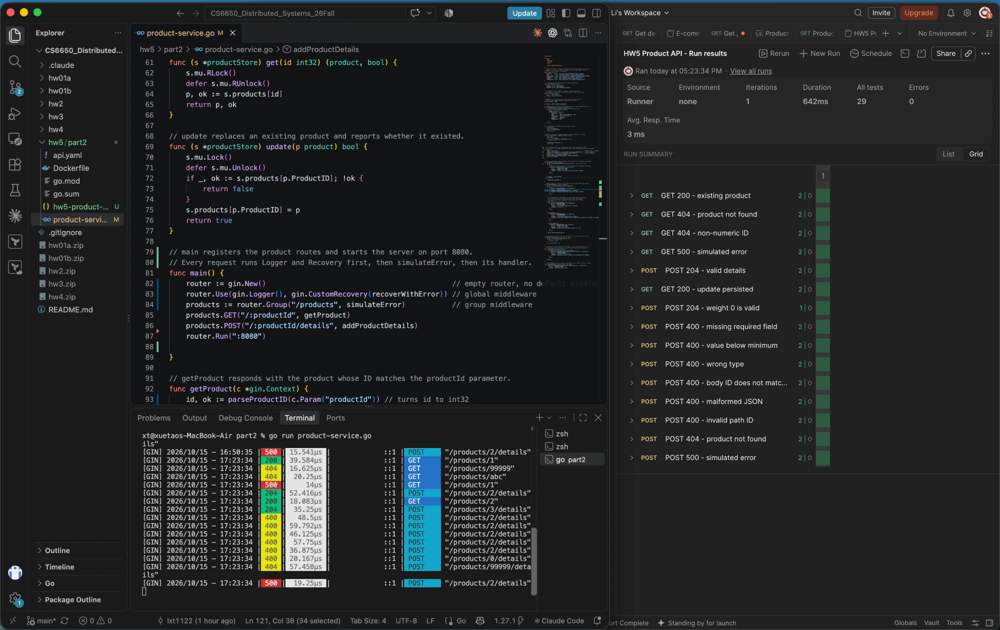
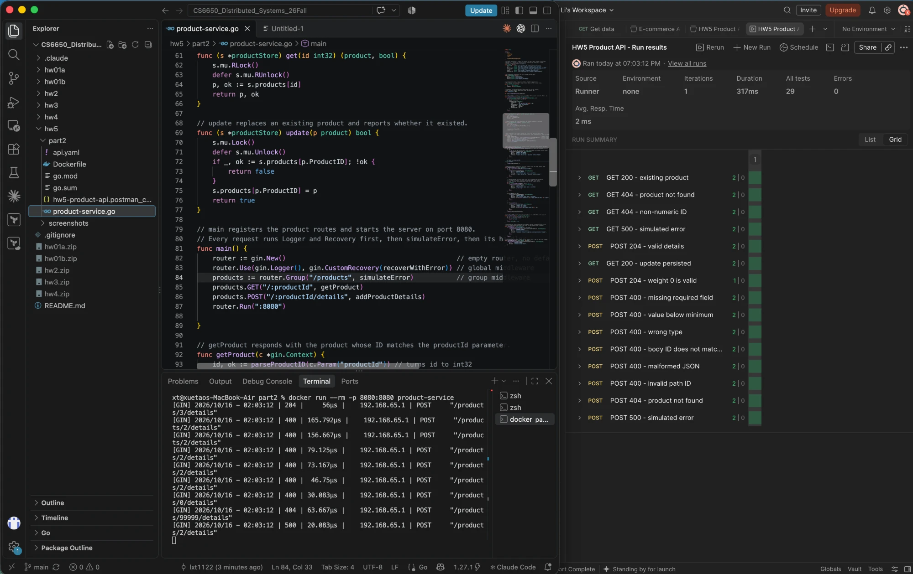

## Load testing

```
cd locust
TARGET_HOST=http://<PUBLIC-IP>:8080 docker compose up --scale worker=4
# FastHttpUser: prefix with LOCUSTFILE=locustfile_fast.py
```

Each user sends GET and POST in a 9:1 ratio, since a store is read-heavy. Product IDs are random and there is no wait time between requests. The target is one Fargate task (0.25 vCPU).

| Test | Users (spawn/s) | RPS | p50 | p95 | Failures | ECS CPU |
|---|---|---|---|---|---|---|
| Baseline, HttpUser | 1 (1) | 36 | 27 ms | 29 ms | 0 | ~0% |
| Stress, HttpUser | 500 (5) | 2,649 | 110 ms | 300 ms | 0 | ~100% |
| Stress, FastHttpUser | 500 (5) | 2,672 | 110 ms | 300 ms | 0 | ~100% |

- **Where it struggles:** throughput plateaus at about 2,650 RPS from roughly 350 users, when CPU reaches 100%. Beyond that, extra users only queue: p50 rises to about 190 ms (500 / 2,650, Little's Law), and nothing fails.
- **HttpUser vs FastHttpUser:** the results are the same because the server is the bottleneck. FastHttpUser only helps when the Locust client itself is the limit.
- **Read-heavy tradeoff:** map lookups are O(1), and the RWMutex lets GETs run in parallel. GET and POST latencies are equal under load, so the 10% writes cause no lock contention.

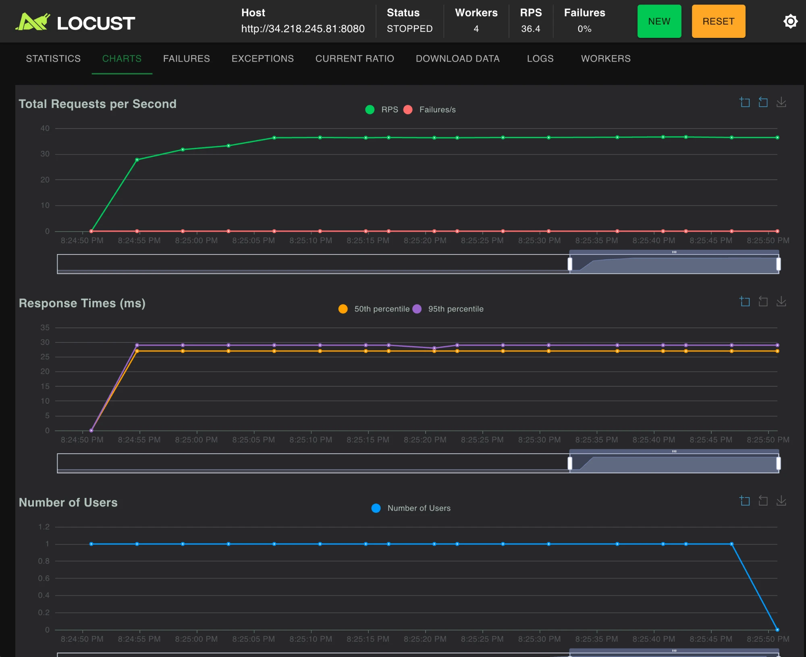
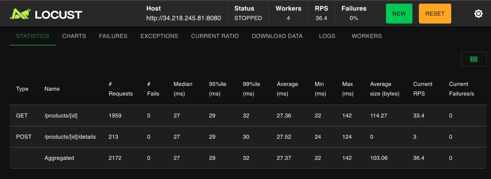
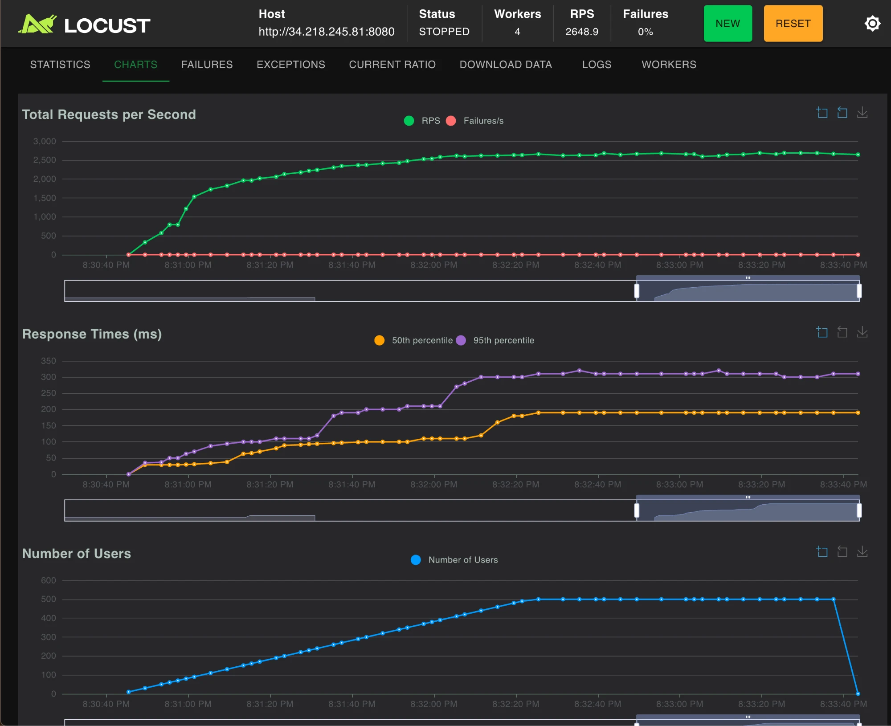
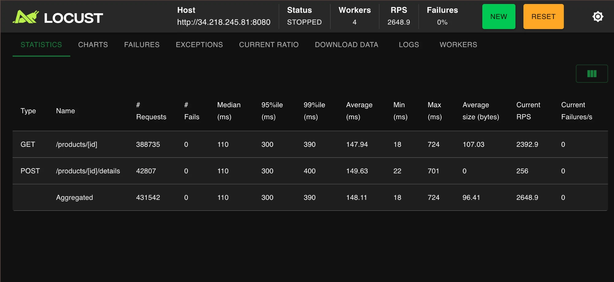
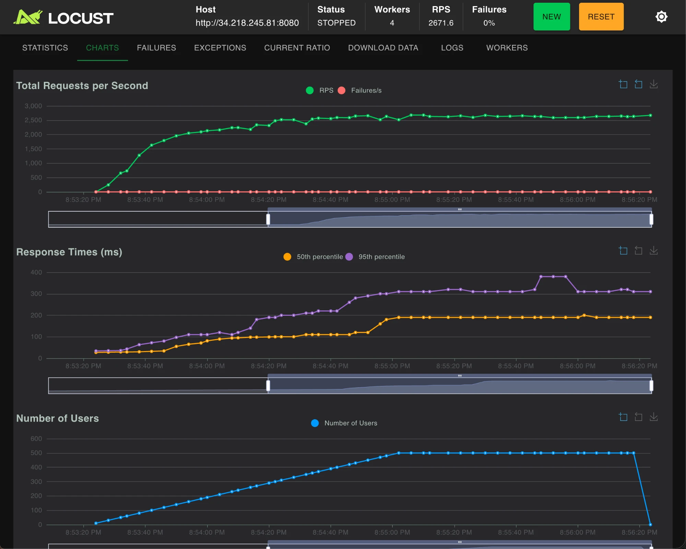
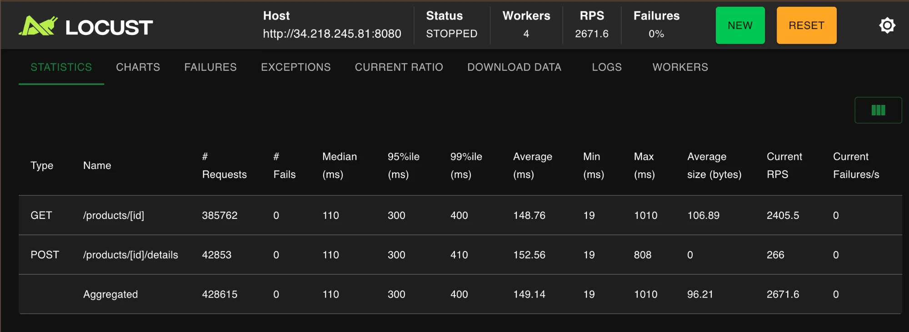

ECS CPU (CloudWatch, UTC). The spikes at 03:31 and 03:54 are the HttpUser and FastHttpUser runs:

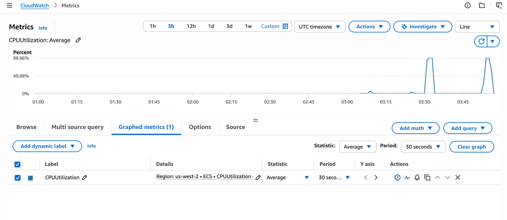

## Observability

```
cd observability
docker compose up --build --scale worker=4
```

This starts the app on :8080, Prometheus on :9090, Grafana on :3000 (dashboard "Product API - RED") and Locust on :8089. The server exposes RED metrics at `/metrics` and logs one JSON line per request. The stack runs locally, so this is the Part IV test rerun against the local app, which is capped at 0.25 CPU to match Fargate (200 users, 3 minutes).

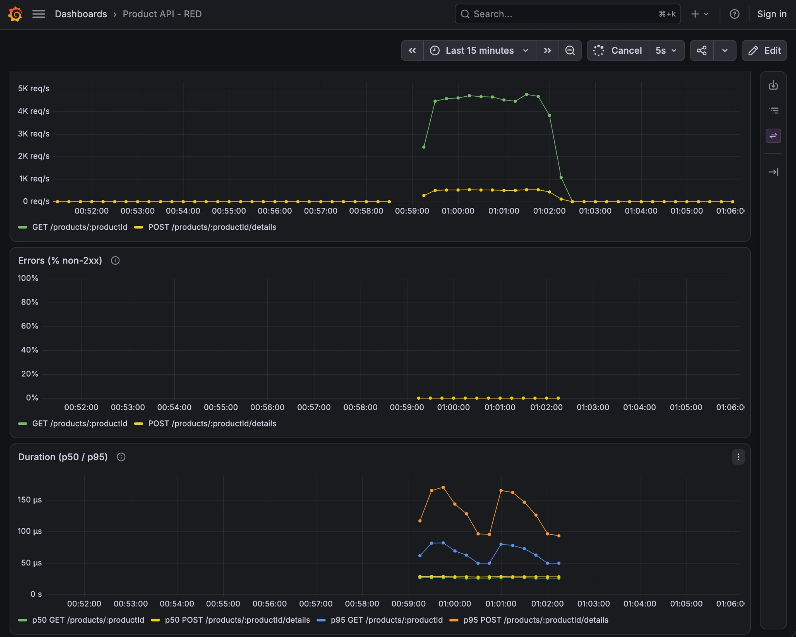

| Signal | Loaded | Idle |
|---|---|---|
| Rate | ~4,600 GET/s, ~515 POST/s | 0 |
| Errors | 0% | no data (0/0) |
| Duration | p50 ~27 µs, p95 50–170 µs | no data (no requests) |

Grafana measures time inside the handler, while Locust measures the whole request: p50 16 ms, p95 77 ms. The gap is time spent waiting for the CPU-capped container, which happens before a request reaches Gin.

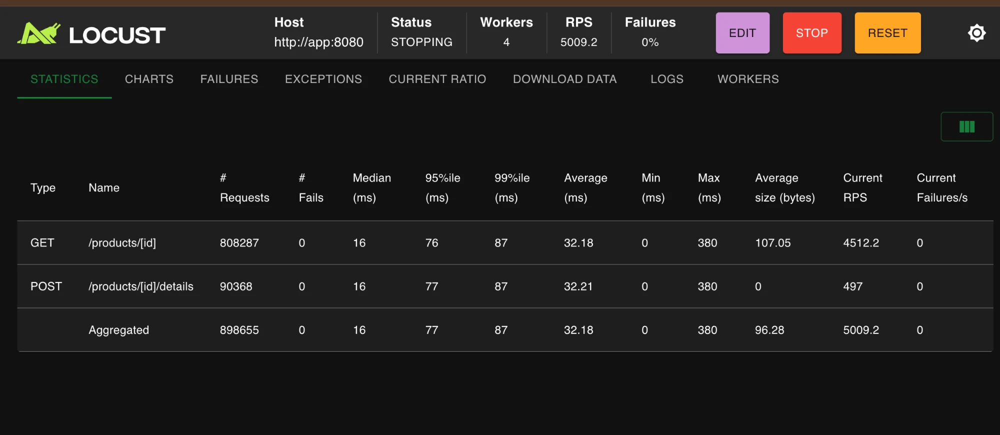

Request log excerpt from the same run:

```json
{"time":"2026-10-16T08:00:07.999931167Z","level":"INFO","msg":"request","method":"GET","endpoint":"/products/:productId","path":"/products/347","status":200,"duration_ms":0.004}
{"time":"2026-10-16T08:00:08.000173Z","level":"INFO","msg":"request","method":"POST","endpoint":"/products/:productId/details","path":"/products/504/details","status":204,"duration_ms":0.009}
{"time":"2026-10-16T08:00:08.003628625Z","level":"INFO","msg":"request","method":"GET","endpoint":"/products/:productId","path":"/products/389","status":200,"duration_ms":0.012}
```

**Dashboard vs logs:** the dashboard is for watching trends live, such as whether latency or errors are rising. The logs are for investigating specific requests after the fact, such as which path returned a 500 and when.
