# CS6650 HW6 – Scalability

## Part II: Identifying Performance Bottlenecks

| Metric | Test 1 (5 users, 2 min) | Test 2 (20 users, 3 min) | 512 CPU (20 users, 3 min) |
|---|---|---|---|
| RPS | 170 | 614 | 657 |
| Locust p50 / p95 / p99 | 28 / 35 / 98 ms | 30 / 37 / 110 ms | 29 / 35 / 50 ms |
| Failures | 0 | 0 | 0 |
| Server p50 / p95 (Grafana) | ~250 / ~700 µs | ~200 / ~800 µs (spikes to 1.1 ms) | ~180 / ~400–650 µs |
| ECS CPU (1-min avg) | 32% | 93% | 40% |
| ECS memory | 6.6% → 11% | ~11% | 5.7% (of 1024 MB) |

- **5 users:** throughput is capped by round-trip time, not the server. Each user waits ~28 ms per request, so 5 users send at most ~178 RPS and CPU stays at 32%.
- **20 users:** CPU reaches 93%, so the task is at its limit while memory stays at ~11%. Latency rises only slightly (p99 98 → 110 ms), because the 28 ms network round trip still dominates the ~1 ms server time.
- **Memory:** it rises under load from per-request allocations and falls back afterwards, far below 512 MB.
- **Optimize or scale:** scale. Every search does the same fixed work in under 1 ms with no errors, and CPU is the only resource near its limit, so more CPU or more tasks would raise capacity.
- **Scaling decision from CloudWatch:** 614 RPS uses 93% CPU, so one task handles about 460 RPS at a 70% target. Sustained CPU above that means adding a task.

**Grafana vs CloudWatch**
- **Agree:** both show load starting and stopping at the same time, and CPU rises with request rate (3.6× the RPS, 2.9× the CPU).
- **Grafana only:** server p95 rises from ~700 to ~800 µs and spikes to 1.1 ms at 20 users, a sign of queuing that CPU% alone doesn't show. It also shows 0% errors, and that most of Locust's 28 ms is network.
- **CloudWatch only:** how close the task is to its CPU limit (93%) while memory has plenty of room, which decides whether more compute would help.
- **Resolution:** Grafana updates every 5 s. CloudWatch's default 5-minute period showed Test 1's CPU peak as 8.7%; at 1-minute resolution it is 32%.

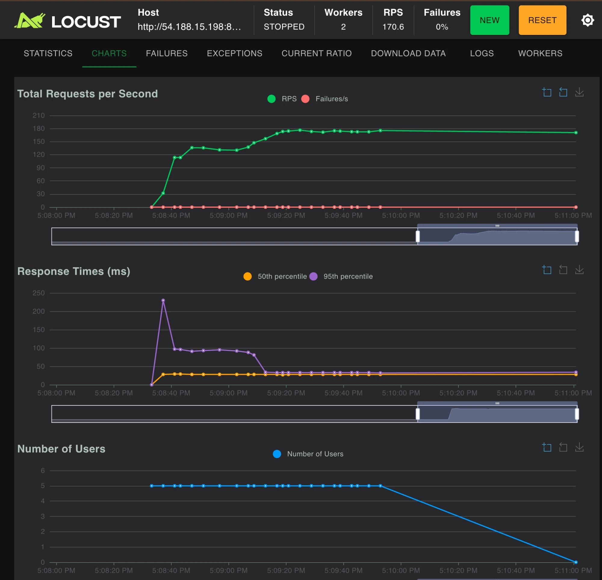
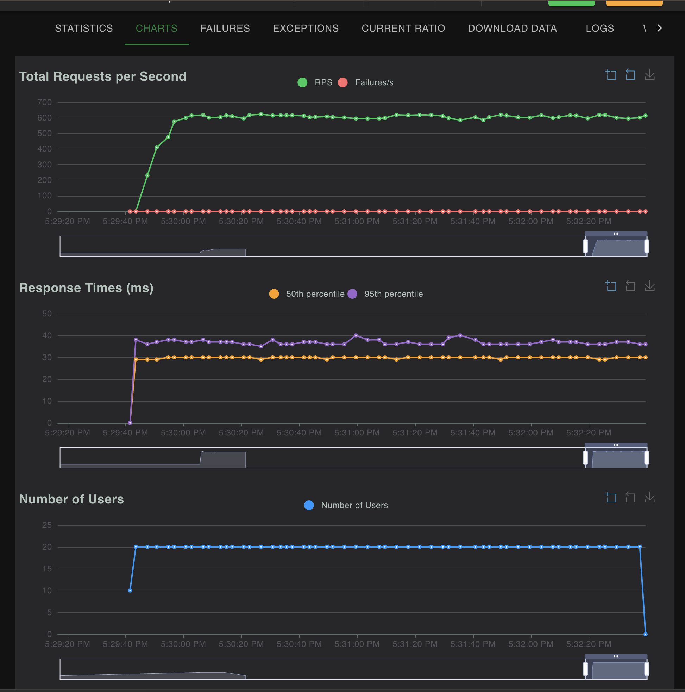

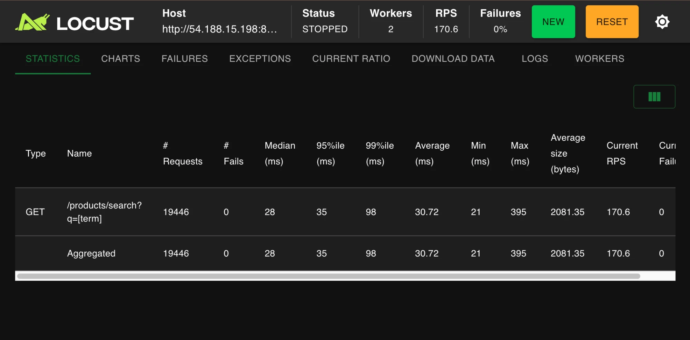
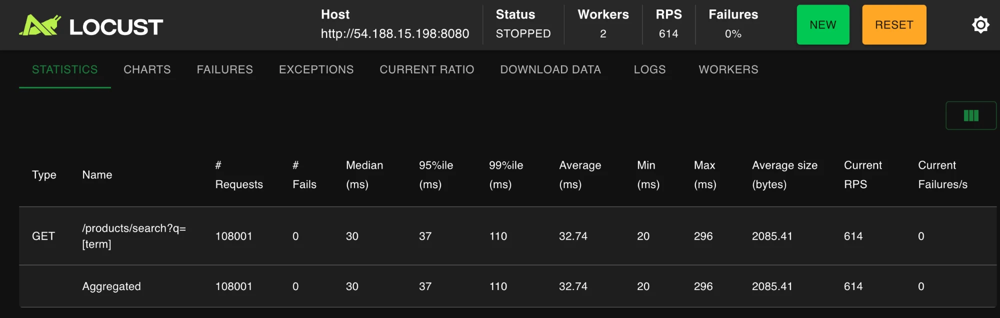

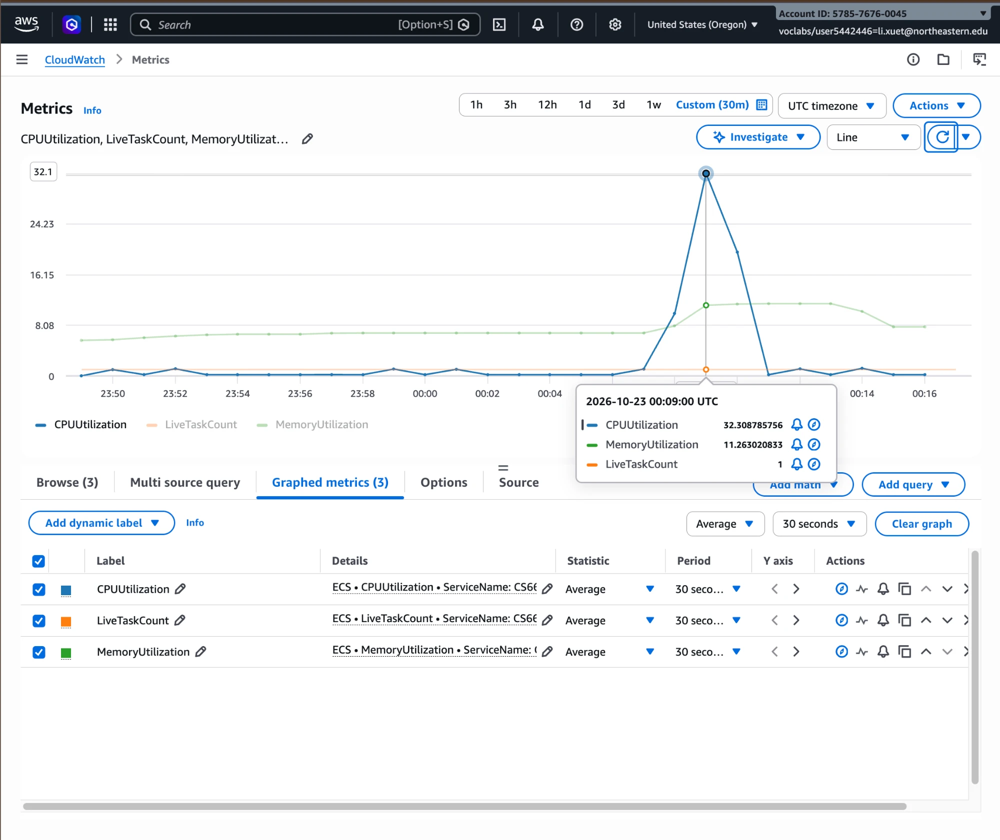

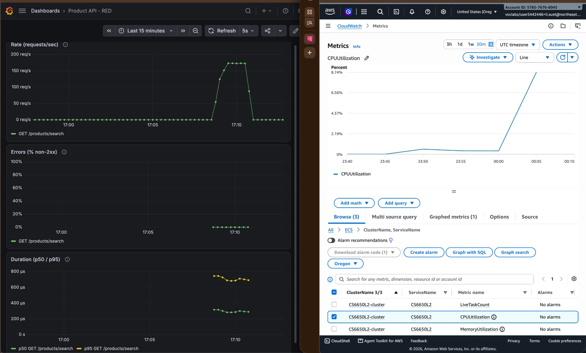

Left column: Test 1. Right column: Test 2. Bottom: Test 1 with CloudWatch's default 5-minute period.

**Creative stress testing**
- **Doubling CPU (256 → 512 units, 1024 MB):** with the same 20 users, CPU drops from 93% to 40% and p99 halves (110 → 50 ms), because requests no longer queue for CPU. RPS barely changes (614 → 657), since 20 users ÷ ~31 ms per request still caps throughput.
- **Takeaway:** more compute fixes this bottleneck, but one bigger task is still a single point of failure with a size limit.

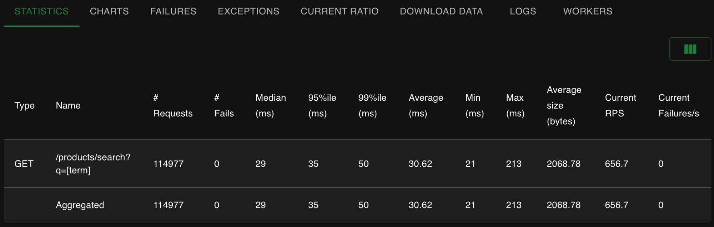

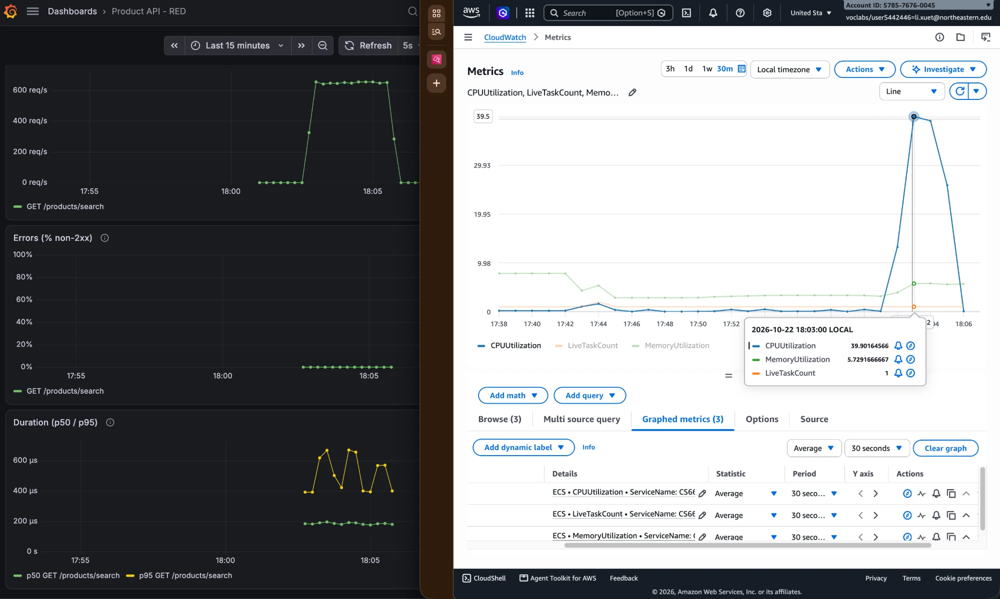

## Part III: Horizontal Scaling with Auto Scaling

### Core Test: the Part II breaking load (20 users, 3 min) through the ALB

| Metric | Part II Test 2 (1 task, direct) | Core Test (2 tasks, ALB) |
|---|---|---|
| RPS | 614 | 596 |
| Locust p50 / p95 / p99 | 30 / 37 / 110 ms | 32 / 37 / 79 ms |
| Failures | 0 | 0 |
| Server p50 / p95 (Grafana) | ~200 / ~800 µs | ~160 / ~350 µs |
| ECS CPU (1-min avg) | 93% | ~41% per task |
| Desired / running tasks | 1 / 1 | 2 / 2 (no scale-out) |
| Healthy targets | — | 2 of 2 (us-west-2a, us-west-2c) |
| ALB TargetResponseTime | — | ~1–1.5 ms |

- **Bottleneck solved:** the minimum 2 tasks split the load that pushed one task to 93%, so each runs at ~41%. That is below the 70% target, so auto scaling never added a task.
- **Load distribution:** the two tasks' CPU lines overlap, so the ALB spreads requests evenly across two availability zones.
- **Response times:** tasks no longer queue for CPU, so server p95 halves and p99 drops from 110 to 79 ms. p50 rises ~2 ms from the extra ALB hop.
- **Throughput:** unchanged at ~600 RPS, since 20 users ÷ ~33 ms per request still caps it.
- **Availability:** 0 failures, and both targets stayed healthy the whole test.
- **Grafana only:** its error panel caught 404s to paths like `/` and `/boaform/admin/formLogin`, internet scanners hitting the tasks' public IPs. CloudWatch's CPU and request count don't separate them from real traffic.

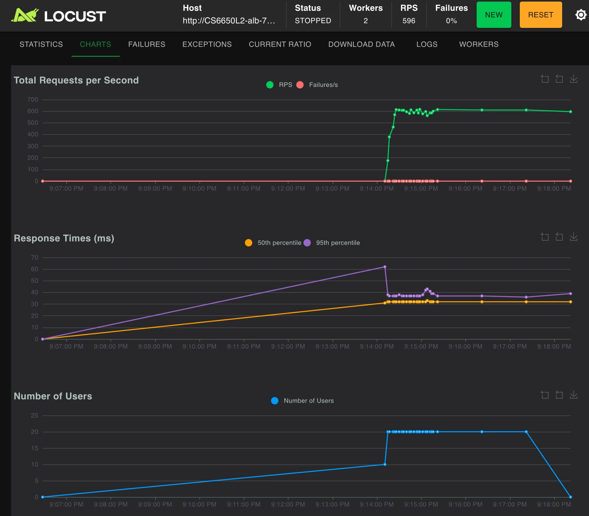
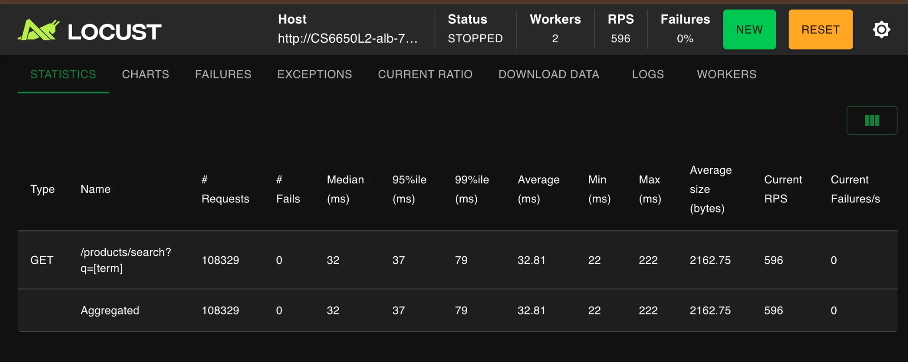

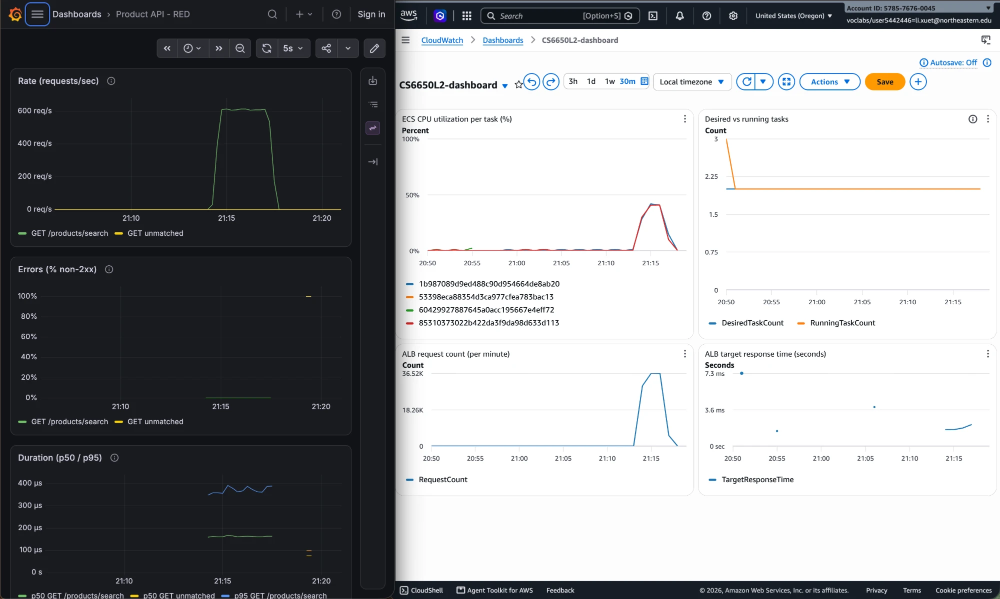
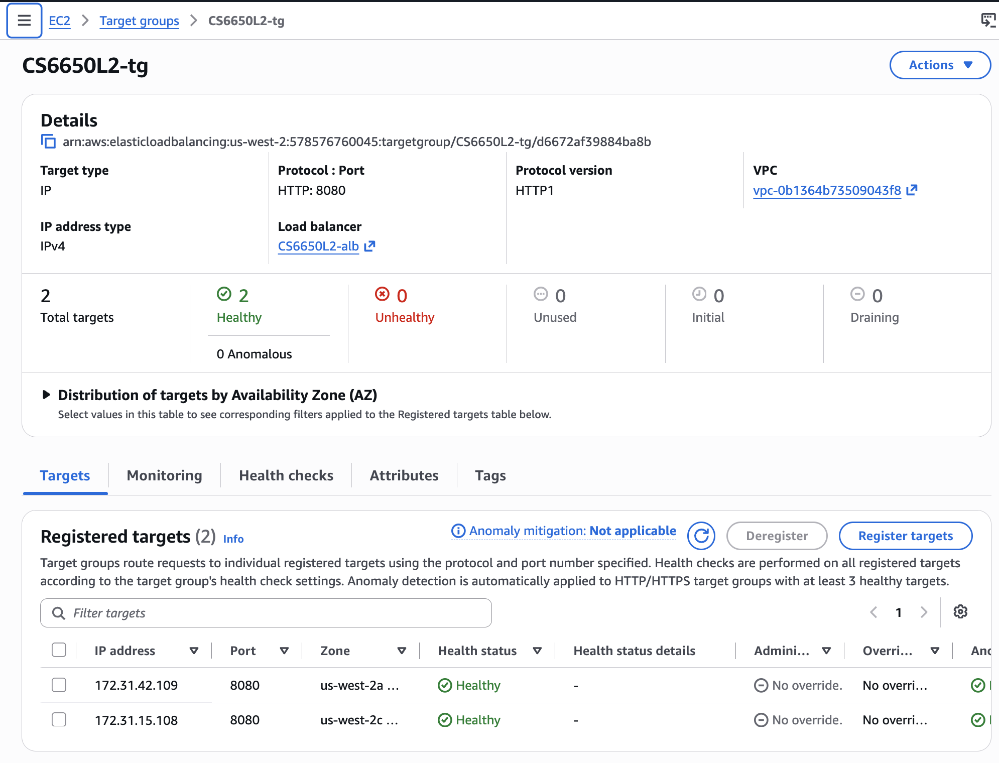

### Scale-out, resilience and scale-in: 60 users, 15 min

The Core Test stayed below 70% CPU, so I raised the load to 60 users for 15 minutes to watch a scale-out, and stopped one task during the same run.

| Metric | 2 tasks (before scale-out) | 3 tasks (after scale-out) |
|---|---|---|
| RPS | ~1,600 | ~1,700 |
| Locust p50 / p95 | 32 / 60–100 ms | 32 / ~40 ms |
| ECS CPU per task | ~85% | ~50–65% |
| ALB TargetResponseTime | ~5 ms | ~2.4 ms |
| Failures | 0 | 0 |

| Time | Event |
|---|---|
| 21:41 | 60 users start; both tasks reach ~85% CPU |
| 21:47:15 | The target-tracking AlarmHigh fires; auto scaling sets desired 2 → 3 and ECS starts a 3rd task (~5 min after CPU crossed 70%) |
| 21:47:54 | New task registered in the target group (us-west-2d) |
| 21:54:13 | I stop one task in the ECS console |
| 21:54:47 | ECS deregisters it from the target group; it starts draining |
| 21:54:48 | ECS starts a replacement, since desired is still 3 |
| 21:55:37 | Replacement registered; service back to steady state |
| 22:01:07 | Stopped task finally exits, after the 300 s deregistration delay |
| 21:56 | Load test ends; CPU drops to ~0% |
| 22:12 | The target-tracking AlarmLow fires; auto scaling sets desired 3 → 2 (~16 min after the load stopped) |
| 22:13 | ECS deregisters and drains one task; service back to steady state at 2 (the minimum) |

- **When tasks are added:** about 5 minutes after CPU crosses the target, because the target-tracking alarm needs several consecutive minutes above 70%. The new task takes under a minute to register.
- **Response times as tasks scale:** with a 3rd task, CPU per task drops below 70%, TargetResponseTime halves (~5 → ~2.4 ms) and Locust p95 falls from 60–100 to ~40 ms. Auto scaling stopped at 3, since 3 tasks keep the average under the target.
- **Scale-in is slower than scale-out:** ~16 minutes after the load stopped versus ~5 minutes to scale out, because the low alarm waits for 15 minutes below target before removing a task. It stopped at 2, the minimum.
- **Resilience:** the load test kept 0% failures and ~1,700 RPS while a task was stopped. ECS drains the target before stopping it, so the ALB stops sending it new requests, and a replacement registers within a minute. Afterwards the target group shows 3 healthy targets, still across three availability zones.

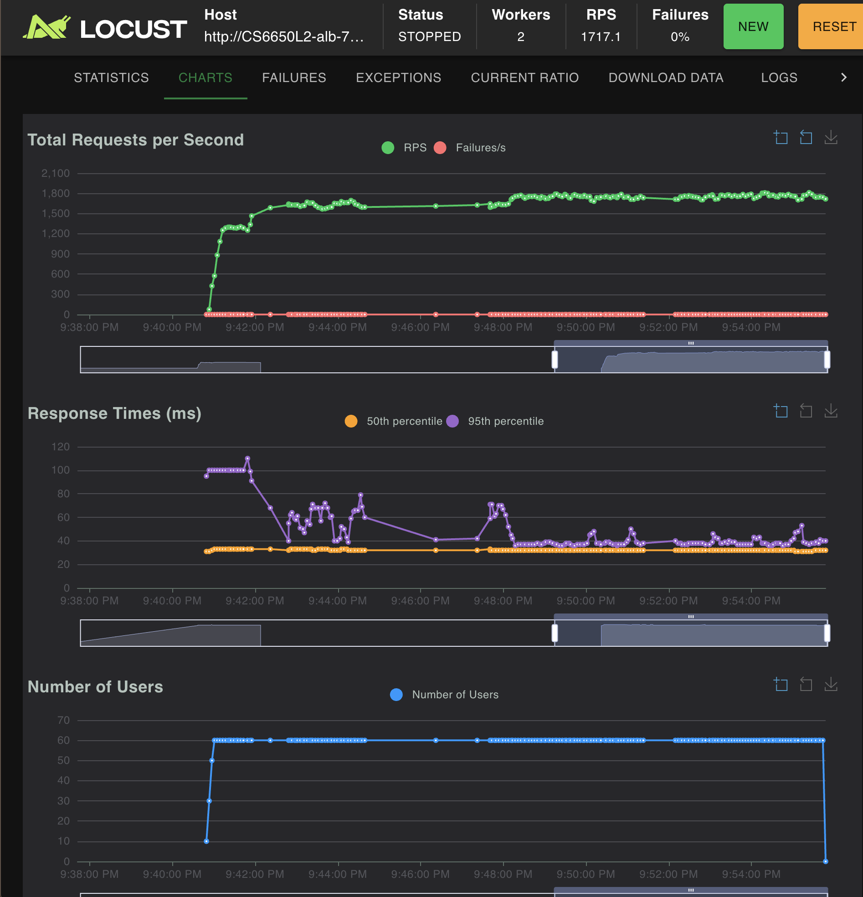
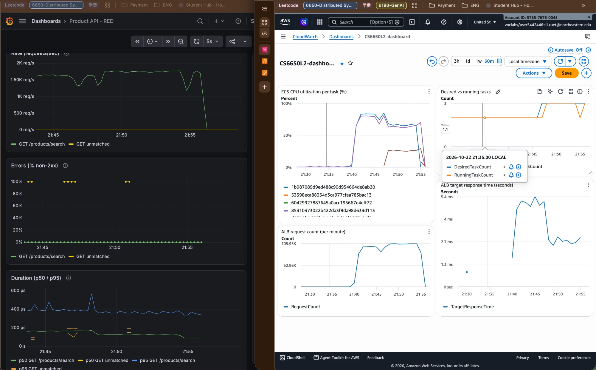

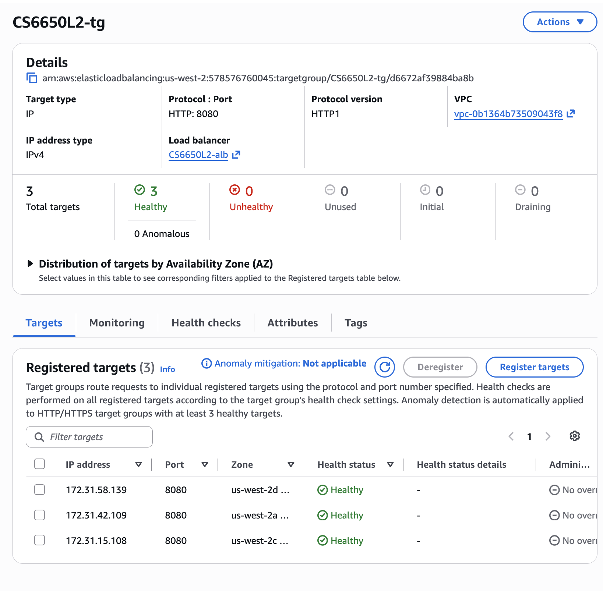
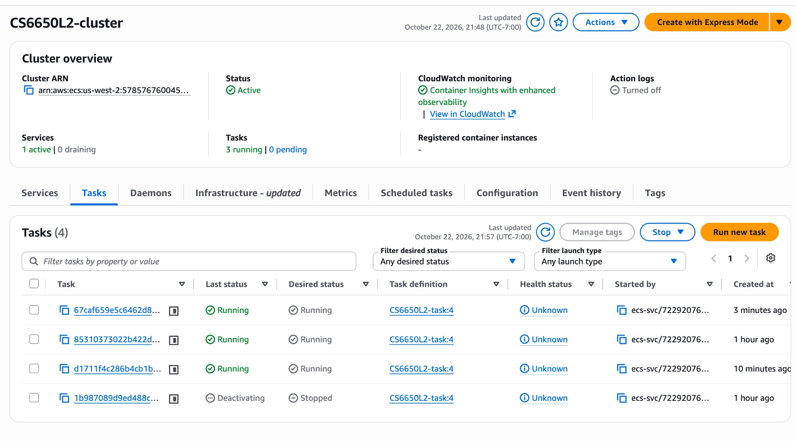

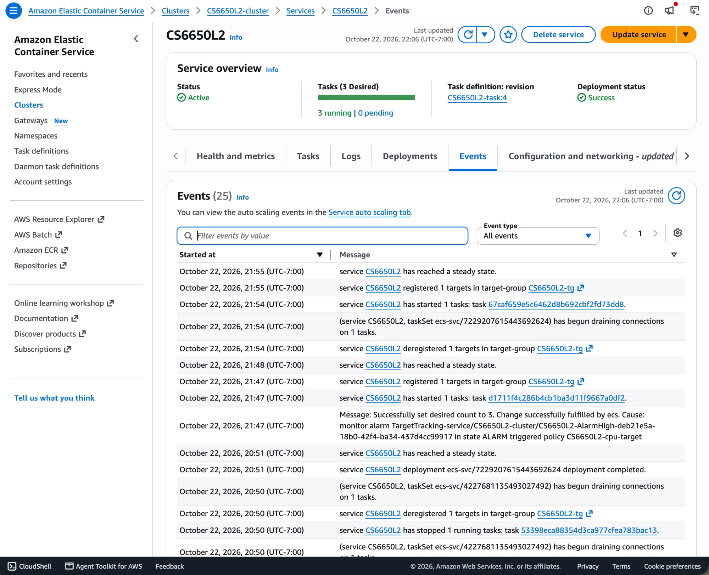
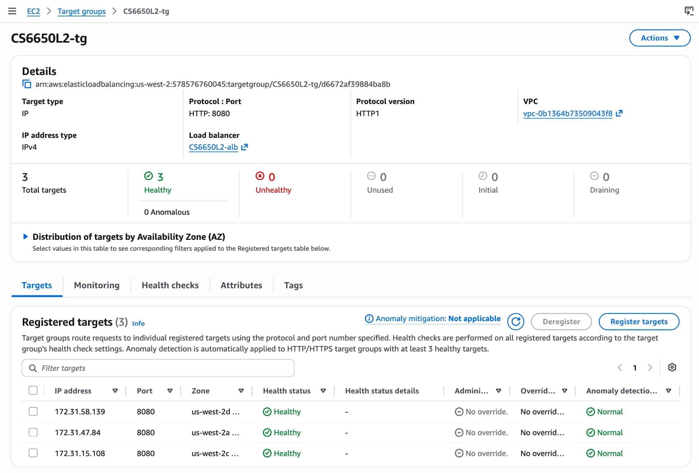

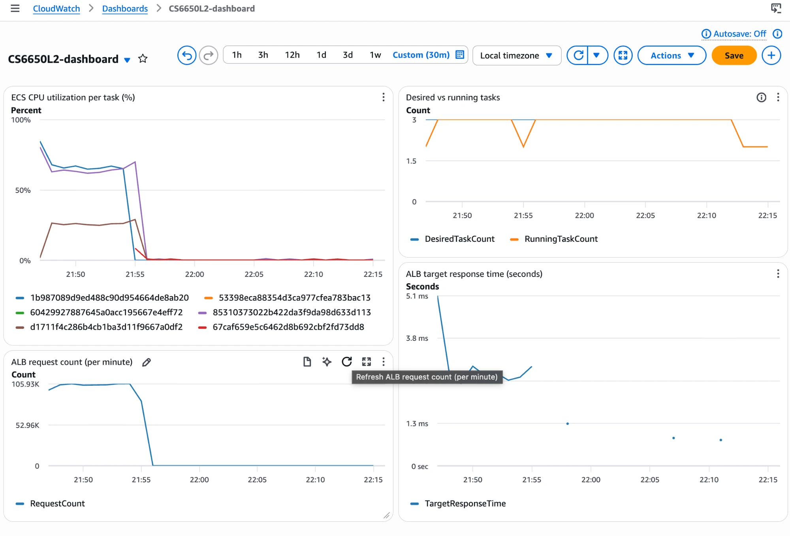
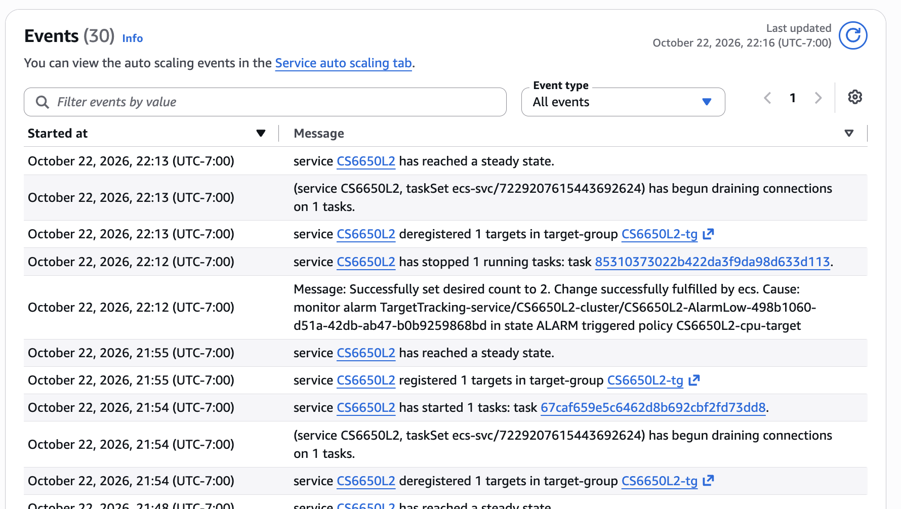

### Exploration

| Experiment | Setting | Observation |
|---|---|---|
| CPU target 50% | min 1, max 5, 60 users | Scaled 1 → 2 → 4 → 5 and held 5 tasks at ~50% CPU, vs 3 tasks at ~62% with the 70% target |
| CPU target 90% | TODO | TODO |
| Min capacity | min 1 | One task ran at ~100% CPU and ~12 ms response time before the first scale-out |
| Max capacity | max 5 | Stopped at 5 tasks even though 60 users needed ~6 at 50% |
| Scale-out cooldown | 300 s | Steps came 8 and 13 minutes apart; one step added 2 tasks (⌈2 × 90% ÷ 50%⌉ = 4) |
| Scale-out cooldown | 60 s | TODO |
| Scale-in | 300 s cooldown | Scale-in started ~16 minutes after the load stopped, one step to the minimum |
| Users | 20 vs 60 | 20 users kept 2 tasks at ~41% (no scale-out); 60 users scaled to 3 |
| Duration | 3 vs 15 min | 3 minutes ends before the alarm fires; 15 minutes shows scale-out and scale-in |
| Gradual ramp | 0 → 60 users over 5 min | TODO |
| Sudden spike | TODO | TODO |
| Stop 2 tasks at once | 5 tasks, 60 users | 0 failures; RPS dropped ~10% and p95 peaked at ~55 ms for about a minute; 2 replacements registered within a minute |
| All health checks fail | path `/broken` | All 5 targets went unhealthy (404); ECS started 5 replacements before stopping the old ones (running 5 → 9), and the new ones failed too. Locust kept 0 failures because the ALB fails open and `/products/search` still worked |

TODO: component roles, vertical vs horizontal trade-offs, scaling predictions, CPU vs request-metric trigger.
