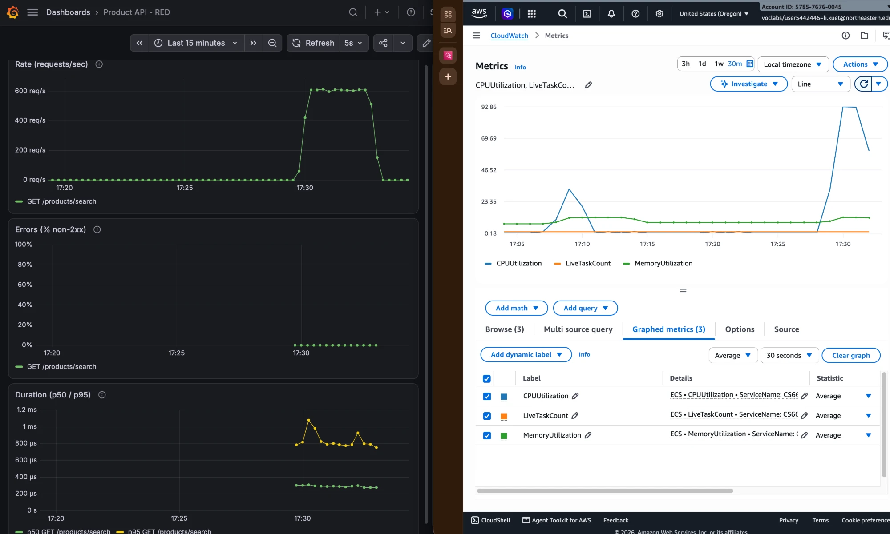
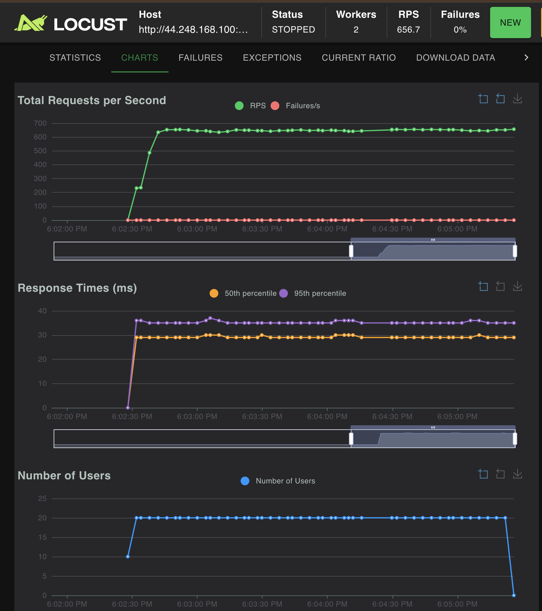

# CS6650 HW6 – Scalability

## Part II: Identifying Performance Bottlenecks

| Metric | Test 1 (5 users, 2 min) | Test 2 (20 users, 3 min) | 512 CPU (20 users, 3 min) |
|---|---|---|---|
| RPS | 170 | 614 | 657 |
| Locust p50 / p95 / p99 | 28 / 35 / 98 ms | 30 / 37 / 110 ms | 29 / 35 / 50 ms |
| Failures | 0 | 0 | 0 |
| Server p50 / p95 (Grafana) | ~250 / ~700 µs | ~200 / ~800 µs (spikes to 1.1 ms) | ~180 / ~400–650 µs |
| ECS CPU (1-min avg) | 32% | 93% | 40% |
| ECS memory | 6.6% → 11% | ~11% | 5.7% (of 1024 MB) |

- **5 users:** throughput is capped by round-trip time, not the server. Each user waits ~28 ms per request, so 5 users send at most ~178 RPS and CPU stays at 32%.
- **20 users:** CPU reaches 93%, so the task is at its limit while memory stays at ~11%. Latency rises only slightly (p99 98 → 110 ms), because the 28 ms network round trip still dominates the ~1 ms server time.
- **Memory:** it rises under load from per-request allocations and falls back afterwards, far below 512 MB.
- **Optimize or scale:** scale. Every search does the same fixed work in under 1 ms with no errors, and CPU is the only resource near its limit, so more CPU or more tasks would raise capacity.
- **Scaling decision from CloudWatch:** 614 RPS uses 93% CPU, so one task handles about 460 RPS at a 70% target. Sustained CPU above that means adding a task.

**Grafana vs CloudWatch**
- **Agree:** both show load starting and stopping at the same time, and CPU rises with request rate (3.6× the RPS, 2.9× the CPU).
- **Grafana only:** server p95 rises from ~700 to ~800 µs and spikes to 1.1 ms at 20 users, a sign of queuing that CPU% alone doesn't show. It also shows 0% errors, and that most of Locust's 28 ms is network.
- **CloudWatch only:** how close the task is to its CPU limit (93%) while memory has plenty of room, which decides whether more compute would help.
- **Resolution:** Grafana updates every 5 s. CloudWatch's default 5-minute period showed Test 1's CPU peak as 8.7%; at 1-minute resolution it is 32%.

Left column: Test 1. Right column: Test 2. Bottom: Test 1 with CloudWatch's default 5-minute period.

**Creative stress testing**
- **Doubling CPU (256 → 512 units, 1024 MB):** with the same 20 users, CPU drops from 93% to 40% and p99 halves (110 → 50 ms), because requests no longer queue for CPU. RPS barely changes (614 → 657), since 20 users ÷ ~31 ms per request still caps throughput.
- **Takeaway:** more compute fixes this bottleneck, but one bigger task is still a single point of failure with a size limit.

## Part III: Horizontal Scaling with Auto Scaling

TODO
